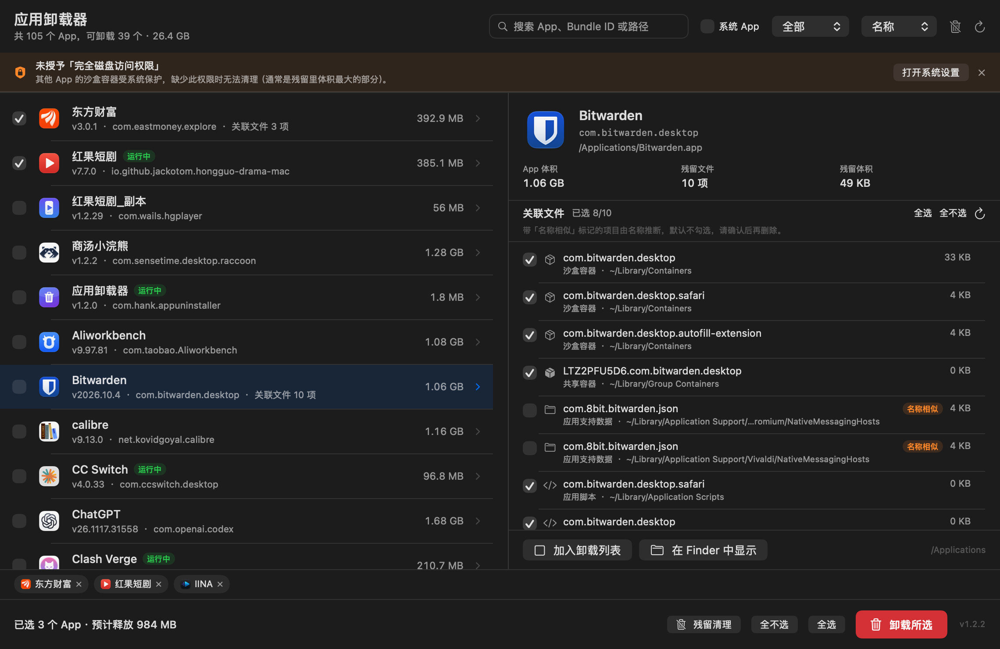
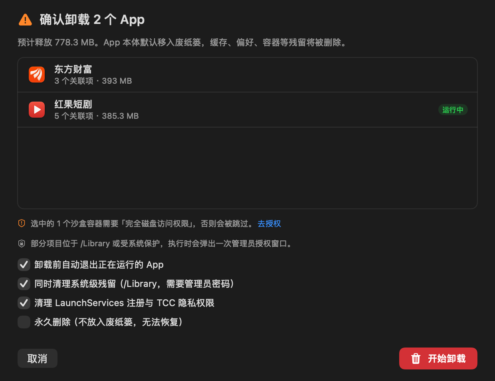
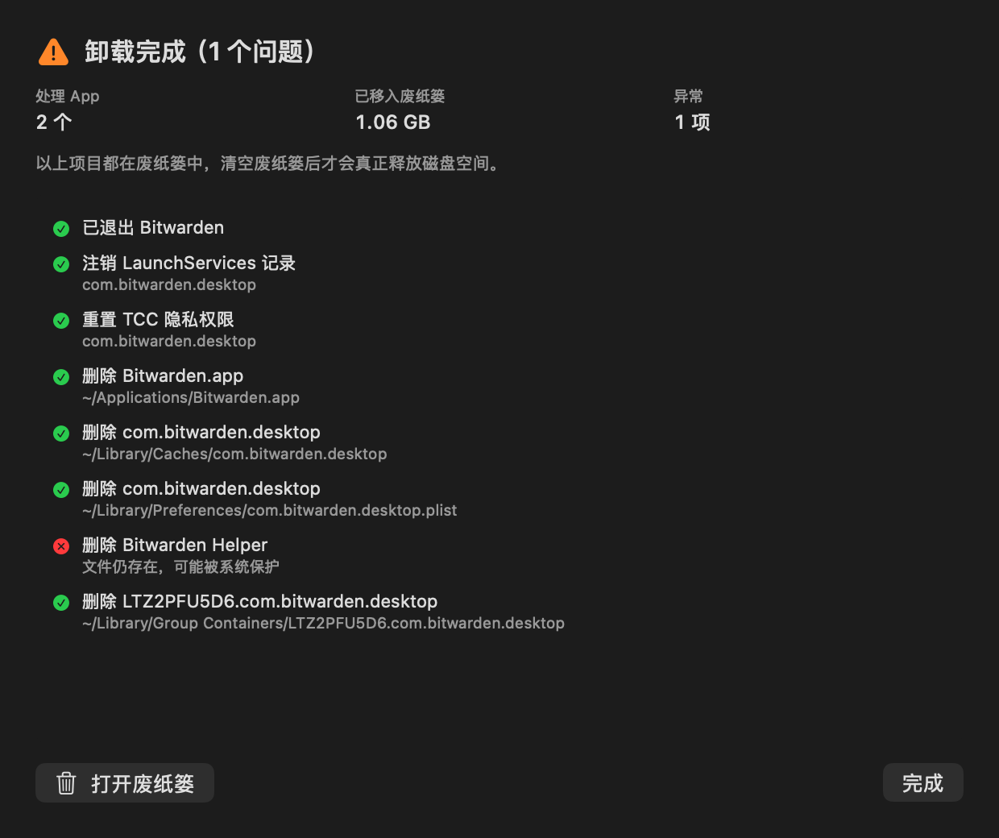
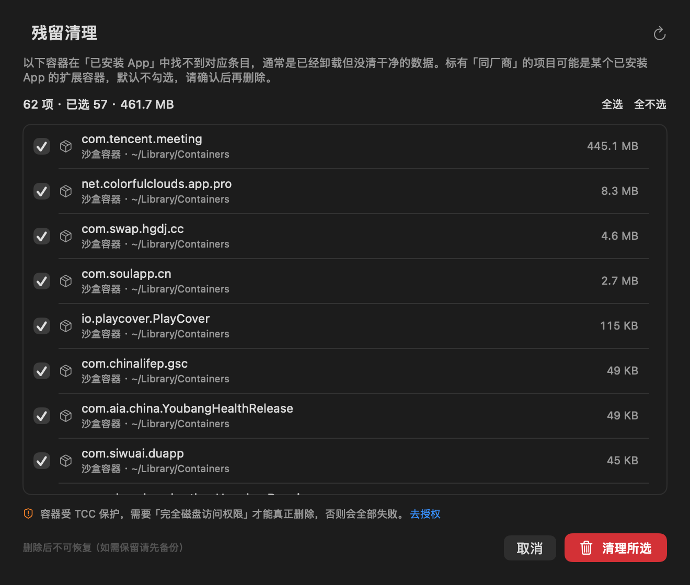

# 应用卸载器 · AppUninstaller

[](https://www.apple.com/macos/)
[](https://swift.org)
[](LICENSE)

原生 macOS 批量卸载工具：扫描本机所有 App，勾选多个后一键卸载，同时清理缓存、偏好设置、沙盒容器、日志、启动项等残留，并注销 LaunchServices / TCC 等「注册表类」信息。



- 纯本地运行，**没有任何网络请求**
- 原生 SwiftUI + AppKit，无第三方依赖，单个可执行文件
- 默认把 App 与残留移入**废纸篓**（可恢复），也可选择永久删除
- 内置「残留清理」，专门收拾已卸载 App 留下的孤儿容器
- 支持筛选、排序、搜索、快捷键与窗口尺寸记忆

> 这是个人自用工具，按「宁可漏删，不可误删」设计：不确定的项目默认不勾选，删除前有确认页，执行后有逐条结果。

---

## 系统要求

| 项目 | 要求 |
| --- | --- |
| 系统 | macOS 13 Ventura 及以上 |
| 芯片 | Apple Silicon / Intel 均可（本机构建对应架构） |
| 构建 | Xcode Command Line Tools（`swiftc`），不需要 Xcode 工程 |
| 运行 | 无额外依赖 |

## 安装

### 方式 A：下载 Release（推荐）

1. 打开 [Releases](https://github.com/mantianfx/AppUninstaller/releases)，下载最新的 `AppUninstaller-x.y.z.zip`；
2. 解压后把 `应用卸载器.app` 拖进「应用程序」；
3. 首次打开：右键点 App →「打开」。

App 使用 ad-hoc 签名（没有开发者公证），直接双击可能提示「无法验证开发者」。如果提示仍在，可执行：

```bash
xattr -dr com.apple.quarantine "/Applications/应用卸载器.app"
```

### 方式 B：从源码构建

```bash
git clone https://github.com/mantianfx/AppUninstaller.git
cd AppUninstaller

./build.sh          # 编译 + 打包 + ad-hoc 签名 → dist/应用卸载器.app
./install.command   # 安装到 /Applications 并打开（也可用 ./install.sh）
```

可选：`./make-icon.sh` 重新生成图标。

> 仓库不包含二进制产物；`dist/`、`.build/` 已在 `.gitignore` 中。

### ⚠️ 重要：完全磁盘访问权限

其他 App 的沙盒容器（`~/Library/Containers`、`~/Library/Group Containers`）受 macOS TCC 保护。**没有「完全磁盘访问权限」时，普通用户甚至 root 都无法修改它们**（`sudo rm` 同样会报 `Operation not permitted`）。

因此第一次使用前建议：

1. 打开 App，点顶部提示条里的「打开系统设置」；
2. 在「隐私与安全性 → 完全磁盘访问权限」中勾选「应用卸载器」；
3. 回到 App，权限状态会自动刷新。

未授权时仍可正常卸载 App 本体、清理缓存/偏好/日志/启动项，但容器会被跳过并在结果里说明，不会静默失败。

> 重新构建或替换 App 后，系统会把它当作新的二进制，需要回系统设置重新勾选一次；授权后若仍失败，退出并重开 App 再试。

---

## 使用流程

1. 启动后自动扫描 `/Applications`、`/Applications/Utilities`、`~/Applications`、`/System/Applications`。
2. 左侧勾选要卸载的 App；支持按名称 / Bundle ID / 路径搜索，按名称、体积、修改时间排序，按「仅已选 / 运行中 / 大于 1 GB」筛选。
3. 点某一行查看右侧**关联文件**：可逐项勾选/取消。标有「名称相似」的项目是按名称推断的，**默认不勾选**。
4. 点右下角红色「卸载所选」，在确认页选择是否退出运行中的 App、是否清理 `/Library`、是否注销注册信息、是否永久删除。
5. 执行完成后给出逐条结果；需要 root 的项目会合并为**一次**系统授权。
6. 默认所有内容都在废纸篓里，清空后才真正释放空间。
7. 已卸载但没清干净的 App，点底部的「残留清理」按钮打开（也可用菜单「操作 → 残留清理…」，快捷键 `⌘⇧O`）。

| 确认卸载 | 卸载结果 |
| --- | --- |
|  |  |

### 残留清理（孤儿容器）

扫描找不到对应 App 的容器条目。识别时会参考 App 的内嵌扩展 Bundle ID、签名中的 App Group 与同厂商前缀；标有「同厂商」的条目可能是已安装 App 的扩展容器，默认不勾选。



---

## 清理范围

| 位置 | 内容 | 所需权限 |
| --- | --- | --- |
| App 本体（`/Applications`、`~/Applications`） | `.app` 包 | 用户权限；受 App 管理保护时回退管理员 |
| `~/Library/Caches`、`/Library/Caches` | 缓存 | 用户 / 管理员 |
| `~/Library/Preferences`、`ByHost` | 偏好 plist | 用户 / 管理员 |
| `~/Library/Application Support` | 应用数据、厂商子目录 | 用户 / 管理员 |
| `~/Library/Containers`、`Group Containers` | 沙盒与共享容器（通常最占空间） | **完全磁盘访问权限** |
| `~/Library/Saved Application State` | 窗口状态 | 用户 |
| `~/Library/Logs`、`CrashReporter`、`DiagnosticReports` | 日志与崩溃报告 | 用户 |
| `~/Library/HTTPStorages`、`WebKit`、`Cookies` | 网页存储 | 用户 |
| `~/Library/Application Scripts` | 分享 / 扩展脚本 | 用户 |
| `~/Library/LaunchAgents`、`/Library/LaunchAgents`、`/Library/LaunchDaemons` | 启动项与守护进程（先 `launchctl bootout`） | 用户 / 管理员 |
| `$TMPDIR` | 临时文件 | 用户 |
| `/Library/PrivilegedHelperTools` | 特权 Helper | 管理员 |
| `/Library/Receipts`、`/private/var/db/receipts` | 安装收据 | 管理员 |
| LaunchServices 数据库 | `lsregister -u` 注销 App 注册 | 用户 |
| TCC 隐私授权 | `tccutil reset All <bundle-id>` | 用户 |

> macOS 没有 Windows 那种注册表。这里的「注册表类信息」对应：LaunchServices 注册、TCC 授权、launchd 启动项、pkg 收据、偏好 plist 等。

## 安全设计

- **只删匹配到的具体条目**，不会递归删除父目录。
- 硬编码保护路径（`/`、`/Applications`、`/Library`、`~/Library/Caches`、`~/Documents`、`~/.Trash` 等），匹配规则出错也拒绝删除。
- App 本体与残留默认移入**废纸篓**；永久删除必须显式打开开关。
- 系统 App（`/System` 下或 `com.apple.*`）显示但不可勾选，也不会出现在残留清理里。
- 「名称相似 / 同厂商 / 低可信」项目默认不勾选。
- 卸载过程中禁止关闭窗口或退出 App，避免删到一半中断。
- 所有判断在本机完成，代码里没有任何网络调用。

## 快捷键

| 快捷键 | 作用 |
| --- | --- |
| `⌘R` | 重新扫描 |
| `⌘F` | 聚焦搜索框 |
| `⌘⇧⌫` | 打开「卸载所选」确认页 |

窗口大小与位置会自动记忆。

## 命令行

```bash
BIN="dist/应用卸载器.app/Contents/MacOS/AppUninstaller"

$BIN --scan                          # 列出所有 App、体积、Bundle ID
$BIN --scan --json                   # JSON 输出
$BIN --leftovers "/Applications/WeChat.app"   # 查看某个 App 的残留清单
$BIN --plan "/Applications/WeChat.app"        # 打印卸载计划（dry-run，不删除）
$BIN --orphans [--json]              # 列出找不到对应 App 的残留容器
$BIN --fda                           # 查看完全磁盘访问权限状态
$BIN --selftest                      # 内置匹配规则 / 安全防护自测
$BIN --uninstall <App> --yes         # 实际执行卸载（危险，仅供自测）
$BIN --render-ui out.png --sheet confirm|report|orphans   # 生成界面截图（开发用）
```

## 已知限制与常见问题

<details>
<summary><b>容器删不掉 / 提示需要完全磁盘访问权限？</b></summary>

这是 macOS 的 TCC 保护，管理员密码无法替代。请按上文授予「完全磁盘访问权限」；授权后若仍失败，退出并重开 App。
</details>

<details>
<summary><b>为什么有些 App 不能勾选？</b></summary>

`/System` 下或 `com.apple.*` 的系统 App 受 SIP 保护，无法删除，因此只展示不可选。
</details>

<details>
<summary><b>为什么清理系统级残留要输密码？</b></summary>

`/Library`、`/Library/LaunchDaemons` 等目录属于 root，需要一次管理员授权。多次操作会合并为一次密码框。
</details>

<details>
<summary><b>钥匙串里的账号密码会被删吗？</b></summary>

不会。Keychain 条目需要在「钥匙串访问」中自行清理。
</details>

<details>
<summary><b>后台项 / 登录项还会残留吗？</b></summary>

通过 `SMAppService` 注册的后台项在 App 被删除后通常会失效；若「系统设置 → 通用 → 登录项」里仍有条目，需要手动移除。
</details>

<details>
<summary><b>同厂商的共享目录为什么没有自动勾选？</b></summary>

例如 `~/Library/Application Support/Google` 可能被同一厂商的多个 App 共用，自动删除风险高，因此只作为「名称相似」展示，需手动确认。
</details>

其他限制：

- 受 SIP 保护的系统组件无法删除。
- 带系统扩展 / 网络扩展 / 守护进程的 App（VPN、杀毒等），卸载后建议重启一次。
- 删除后 Dock 上可能短暂残留图标，注销或拖出即可。
- 存档在容器内的用户数据（聊天记录、文档等）删除后不可恢复，操作前请备份。

## 项目结构

```
AppUninstaller/
├── Sources/
│   ├── Model.swift        数据模型、体积格式化
│   ├── Scanner.swift      扫描 App、元数据、体积、内嵌扩展与 App Group
│   ├── Leftovers.swift    残留发现与名称匹配规则
│   ├── Orphans.swift      孤儿容器识别
│   ├── Permissions.swift  完全磁盘访问权限检测
│   ├── Uninstaller.swift  退出进程、删除、管理员脚本、注销注册
│   ├── State.swift        界面状态（选择、残留、进度）
│   ├── UI.swift           SwiftUI 界面
│   ├── CLI.swift          命令行与内置自测
│   ├── Snapshot.swift     界面离屏渲染（开发用）
│   └── main.swift         入口 / AppDelegate / 菜单
├── Resources/Info.plist / AppIcon.icns
├── Scripts/make_icon.swift
├── build.sh               构建（编译 + 打包 + 签名）
├── make-icon.sh           图标生成
├── install.sh             安装到 /Applications
├── install.command        双击安装
└── docs/                  截图
```

构建流程图（简化）：

```
Sources/*.swift ──swiftc──▶ .build/AppUninstaller
                              │
Resources/Info.plist ─────────┼──▶ dist/应用卸载器.app ──codesign(adhoc)──▶ 可运行
Resources/AppIcon.icns ───────┘
```

## 构建与发布

1. 修改 `Resources/Info.plist` 中的 `CFBundleShortVersionString` / `CFBundleVersion`；
2. 运行 `./build.sh`；
3. 打包发布：`ditto -c -k --sequesterRsrc --keepParent "dist/应用卸载器.app" "AppUninstaller-x.y.z.zip"`；
4. 在 GitHub Releases 上传 zip 并写更新说明。

## 更新日志

- **1.2.2**
  - 右下角显示当前版本号（悬停可见 build 号）
- **1.2.1**
  - 修复「残留清理」入口图标在部分系统上不显示的问题（原 SF Symbol `broom` 不存在）
  - 新增底部带文字的「残留清理」按钮，以及「操作 → 残留清理…」菜单项（`⌘⇧O`）
- **1.2.0**
  - 新增「残留清理」：孤儿容器扫描与清理，支持内嵌扩展、App Group、同厂商前缀识别
  - 新增完全磁盘访问权限检测、顶部提示、菜单入口与一键跳转
  - 容器失败不再显示误导性 TCC 报错，改为权限指引；报告附带真实失败原因
  - 孤儿清理固定移入废纸篓，避免继承主界面的「永久删除」状态
- **1.1.0**
  - 新增筛选（仅已选 / 运行中 / 大于 1 GB）、底部已选清单、`⌘R` `⌘F` `⌘⇧⌫` 快捷键、窗口尺寸记忆
  - 确认页增加管理员授权提示；修复重扫后已选项体积丢失
- **1.0.0**
  - 首个版本：扫描、多选、残留清理、注册信息注销、结果报告

## 许可证

[MIT](LICENSE) © 2026 hank

## English

AppUninstaller is a native macOS utility for uninstalling multiple apps at once and cleaning their leftovers — caches, preferences, sandbox containers, logs, launch agents, receipts — plus LaunchServices/TCC registrations. It is fully local, has no network access, moves items to the Trash by default, and asks for Full Disk Access only when protected app containers need to be removed.

Built with SwiftUI/AppKit and the system Swift toolchain; no Xcode project, no third-party dependencies.
